# CẨM NANG KỸ SƯ & BỘ CÂU HỎI PHẢN BIỆN BAN GIÁM KHẢO (Q&A DEFENSE GUIDE)
**Dự án:** CONQUEROR-1 — Mini-PULP Edge AI SoC với Bộ Tăng Tốc Phần Cứng Logarit Không Dùng DSP (Zero-DSP LA-HWPE)  
**Phiên bản phần cứng:** `opt/ultra-low-lut-hardware` (Tag: `v1.2.0-extreme-low-lut` — Kiến trúc Siêu Nhẹ **< 1,700 LUTs SoC / 910 LUTs AI Core**)  
**Tác giả:** Nguyễn Văn Thực (MSSV: 24161421) — Khoa Điện - Điện tử, Trường Đại học Sư phạm Kỹ thuật TP.HCM (HCMUTE)  
**Phần cứng thực thi:** TUL PYNQ-Z2 (`xc7z020clg400-1`) & Digilent Zybo Z7-10 (`xc7z010clg400-1`) + ASIC Nangate 45nm OpenCell  

---

## PHẦN 1: NHỮNG GÌ KỸ SƯ CẦN NẮM VỮNG VỀ DỰ ÁN NÀY (CORE ENGINEERING KNOWLEDGE)

### 1.1. Bức Tranh Tổng Thể: Đây là một SoC hoàn chỉnh (Full Custom RTL), KHÔNG phải dùng nhân ARM có sẵn của Zynq
Điểm quan trọng nhất khi đứng trước Hội đồng: **Toàn bộ hệ thống chạy hoàn toàn trên miền Programmable Logic (PL - FPGA Fabric)** bằng mã nguồn SystemVerilog IEEE 1800-2012 tự thiết kế từ đầu (Full Custom RTL), **không hề sử dụng vi xử lý cứng ARM Cortex-A9** của chip Zynq để tính toán AI.
* **Control Plane (Miền điều khiển — Chỉ chiếm 658 LUTs & 183 FFs):**
  * Lõi vi xử lý **32-bit RISC-V RV32I** ([`rtl/soc/riscv_core_rv32i.sv`](file:///workspace/projects/pulp_edge_ai_soc/rtl/soc/riscv_core_rv32i.sv)) tự thiết kế (FSM 4 trạng thái: `FETCH -> DECODE -> EXECUTE -> WAIT_IRQ`), sử dụng bộ Cộng/Trừ/So sánh 33-bit hợp nhất, Bộ dịch Barrel Shifter đảo bit hai chiều và Tập thanh ghi `RAM32M`.
  * Bộ nhớ **Boot ROM 4 KB** ([`sw/firmware/boot_rom.hex`](file:///workspace/projects/pulp_edge_ai_soc/sw/firmware/boot_rom.hex)) và **Data SRAM 4 KB**.
  * Mạng kết nối **Crossbar Bus Interconnect** ([`rtl/soc/soc_bus_interconnect.sv`](file:///workspace/projects/pulp_edge_ai_soc/rtl/soc/soc_bus_interconnect.sv)) giải mã địa chỉ Memory-Mapped I/O (MMIO) và ngoại vi **UART TX 115,200 bps** ([`rtl/soc/uart_tx.sv`](file:///workspace/projects/pulp_edge_ai_soc/rtl/soc/uart_tx.sv)).
* **Data Plane (Miền dữ liệu tốc độ cao — Bộ tăng tốc tự trị LA-HWPE chỉ chiếm 910 LUTs & 410 FFs):**
  * Lấy cảm hứng từ kiến trúc **PULP (Parallel Ultra-Low-Power)** của ETH Zurich: CPU không trực tiếp nhân ma trận mà chỉ ghi thanh ghi CSR kích hoạt, sau đó ngủ (`WFI`) chờ ngắt `hwpe_irq`.
  * Bộ tăng tốc **LA-HWPE** ([`rtl/top/pulp_hwpe_top.sv`](file:///workspace/projects/pulp_edge_ai_soc/rtl/top/pulp_hwpe_top.sv)) tự chủ hoàn toàn việc quét bộ nhớ chỉ số khác 0, tính toán 1x4 SIMD, lượng tử hóa ngược ReLU và tìm nhãn chiến thắng Argmax.

---

### 1.2. Bản Đồ Bộ Nhớ Hệ Thống (System Memory Map)

| Phân Vùng Địa Chỉ | Dung Lượng | Khối Phần Cứng | Chức Năng Trong SoC |
| :--- | :---: | :--- | :--- |
| `0x0000_0000 – 0x0000_0FFF` | 4 KB | **Boot ROM** | Chứa firmware RISC-V khởi động và kịch bản kiểm thử tự động (BIST). |
| `0x1000_0000 – 0x1000_0FFF` | 4 KB | **Data SRAM** | Ngăn xếp (Stack) và biến cục bộ của CPU RISC-V RV32I. |
| `0x2000_0000` | 32-bit | **HWPE_STATUS / CTRL** | Ghi `bit[0]=1` để kích hoạt LA-HWPE; Đọc `{pred[7:4], busy[1], done[0]}`. |
| `0x2000_0004` | 32-bit | **HWPE_PRED_CLASS** | Kết quả chữ số nhận diện `0..9` từ bộ Argmax phần cứng. |
| `0x2000_0008` | 32-bit | **HWPE_CYCLE_COUNT** | Bộ đếm chu kỳ phần cứng thực tế của 1 lần suy luận (Hardware Performance Counter). |
| `0x2000_1000 – 0x2000_1C3F` | 784 Words | **TCDM Image Buffer** | Bộ nhớ đệm chứa bức ảnh đầu vào $28 \times 28 = 784\text{ pixels}$ (7-bit unsigned `0..127`). |
| `0x3000_0000` | 32-bit | **UART_TX_DATA** | Thanh ghi truyền dữ liệu kết quả qua cổng UART 115,200 baud. |

---

### 1.3. Năm Đóng Góp Kỹ Thuật Cốt Lõi (5 Key Architectural Innovations)

1. **Số học Logarit Tách Kênh Không Dùng DSP ([`lutalm_core_mul_s8.sv`](file:///workspace/projects/pulp_edge_ai_soc/rtl/core/lutalm_core_mul_s8.sv) — Zero-DSP Mitchell LNS):**
   * Trên các FPGA giá rẻ / thiết bị biên, khối nhân cứng `DSP48E1` là tài nguyên khan hiếm và ngốn điện nhất.
   * Thay vì nhân 2 số nguyên 8-bit ($A \times W$), mạch chuyển sang miền Logarit nhị phân cơ số 2:
     $$\log_2(|A \cdot W|) = \log_2(|A|) + \log_2(|W|)$$
   * **Cải tiến đột phá:** Trọng số $W$ đã cố định sau huấn luyện nên được **tiền mã hóa ngoại tuyến (Offline Log8 Pre-encoding)** thành 8-bit `{zero_flag[7], sign[6], char[5:3], frac[2:0]}`. Do đó, phần cứng chỉ cần bộ chuyển đổi Log (`LOD8`) cho nhánh ảnh $A$, cộng số mũ bằng bộ cộng 6-bit, rồi dịch bit ngược qua **Antilog Shifter** với hằng số bù sai số $+1/16$ (`1'b1` ở LSB).
   * **Kết quả:** Tiết kiệm **100% DSP (0 DSP48E1)**, giảm **53.5% diện tích silicon** và giảm **79.3% công suất động** so với bộ nhân INT8 chính xác trên tiến trình ASIC 45nm.

2. **Chuẩn Nén Trọng Số Log8 trên Bus 32-bit ([`tcdm_weight_bram.sv`](file:///workspace/projects/pulp_edge_ai_soc/rtl/memory/tcdm_weight_bram.sv)):**
   * Mạng MLP có cấu trúc `784 -> 64 -> 10` (tổng cộng $50,176 + 640 = 50,816$ trọng số).
   * Nhờ nén mỗi trọng số thành đúng **8-bit Log8** và đóng gói 4 trọng số cho 4 làn PE SIMD vào đúng **1 từ 32-bit**, tổng bộ nhớ TCDM giảm từ **26 khối BRAM36 xuống còn 16 khối BRAM36 (34.6 KB — tiết kiệm 41.7% BRAM)**.

3. **Bộ Điều Khiển Luồng Tự Trị Có Bỏ Qua Điểm Ảnh Bằng 0 ([`hwpe_stream_ctrl.sv`](file:///workspace/projects/pulp_edge_ai_soc/rtl/controller/hwpe_stream_ctrl.sv) — Dynamic Zero-Skipping AGU):**
   * Ảnh chữ viết tay MNIST có tới **~80% điểm ảnh nền bằng 0** ($x_i = 0$).
   * Bộ điều khiển ghi nhận danh sách chỉ số các điểm ảnh khác 0 vào bộ nhớ chỉ số thưa **Block RAM `RAMB18E1` (`sparse_idx_mem`)** kèm bộ đệm nhìn trước 1 chu kỳ (`first_nz_idx_q` & `sparse_raddr`), hoàn toàn không tốn LUT cho mảng chỉ số!
   * **Kết quả:** Giảm số chu kỳ suy luận thực tế từ **12,796 chu kỳ** xuống trung bình chỉ còn **~3,901 chu kỳ** (**39.01 µs @ 100 MHz**, nhanh gấp **3.28 lần** so với pipeline không bỏ qua số 0 và nhanh gấp **130 lần** so với CPU RISC-V thuần).

4. **Đường Ống Hóa PE MAC 2 Tầng Đẩy Bù 2 Sang Stage 2 ([`pe_mac.sv`](file:///workspace/projects/pulp_edge_ai_soc/rtl/core/pe_mac.sv)):**
   * Tách đường dữ liệu tổ hợp thành **Stage 1** (Giải mã LOD8 + Cộng Logarit + Dịch Antilog + Đảo bit 1's complement `base_w`) và **Stage 2** (Hoàn tất bù 2 `base_q + carry_q` + Cộng dồn thanh ghi tích lũy 32-bit `acc_o`).
   * Đạt tần số ký kết **100.0 MHz** trên cả Zybo Z7-10 (`WNS = +0.375 ns`, $F_{\max} = 103.9\text{ MHz}$) và PYNQ-Z2 (`WNS = +0.347 ns`, $F_{\max} = 103.6\text{ MHz}$), đồng thời lõi nhân đạt tới **1.07 GHz (`0.93 ns`)** trên tiến trình ASIC Nangate 45nm.

5. **Cầu Nối Truyền Ảnh Thời Gian Thực Qua Cổng JTAG Nội ([`pynq_z2_board_top.sv`](file:///workspace/projects/pulp_edge_ai_soc/rtl/soc/pynq_z2_board_top.sv) — BSCANE2 `USER4`):**
   * Board TUL PYNQ-Z2 chỉ cắm duy nhất 1 sợi cáp micro-USB JTAG (không cần thẻ SD, không cần cáp UART rời, không cần khởi động Linux).
   * Khối `BSCANE2 #(.JTAG_CHAIN(4))` thu nhận chuỗi lệnh JTAG trên thanh ghi `USER4`, đóng gói **3 điểm ảnh vào mỗi từ 32-bit** (chỉ tốn **262 từ + 1 từ lệnh Start = 8,416 bits/khung hình**).
   * Kết hợp với **Persistent XSDB Daemon ([`scripts/jtag_daemon.tcl`](file:///workspace/projects/pulp_edge_ai_soc/scripts/jtag_daemon.tcl))** mở kết nối JTAG liên tục ở cổng TCP `9999`, thời gian truyền ảnh + suy luận trên FPGA + đọc kết quả về Web chỉ mất **~12–15 ms** (loại bỏ hoàn toàn 10 giây khởi động Vivado).

---

## PHẦN 2: SƠ ĐỒ MẠCH CHI TIẾT KHỐI NHÂN LOGARIT & ĐỘNG CƠ PE MAC (`lutalm_core_mul_s8` & `pe_mac`)

### 2.1. Sơ Đồ Khối Vi Kiến Trúc & Đường Dữ Liệu (Bit-Level Hardware Schematic)

```mermaid
flowchart LR
    subgraph INPUTS["1. Ngõ Vào 8-bit (Inputs)"]
        A["a_i[7:0]<br/>(Signed INT8 Activation)"]
        W["w_log8_i[7:0]<br/>(Pre-Encoded Log8 Weight)<br/>{w_z[7], w_s[6], k_w[5:3], m_w[2:0]}"]
    end

    subgraph STAGE1["2. Tầng Đường Ống 1: Giải Mã Logarit & Dịch Antilog (`lutalm_core_mul_s8`)"]
        ABS["Bộ Lấy Trị Tuyệt Đối<br/>sign_a = a_i[7]<br/>abs_a[7:0] = sign_a ? -a_i : a_i"]
        LOD["Bộ Tìm Bit 1 Đầu Tiên (LOD8)<br/>& Trích Xuất Phần Lẻ Chuẩn Hóa<br/>k_a[2:0] = floor(log2(abs_a))<br/>m_a[2:0] = (abs_a << (7-k_a))[6:4]"]
        ZCHK["Phát Hiện Số 0 & Giải Mã Dấu<br/>is_zero = a_zero | w_z<br/>prod_sign = sign_a ^ w_s"]
        LADD["Bộ Cộng Logarit 6-bit (3.3 Fixed-Point)<br/>{k_sum[3:0], m_sum[2:0]} =<br/>{1'b0, k_a, m_a} + {1'b0, k_w, m_w}"]
        ASHIFT["Bộ Dịch Ngược Antilog + Bù Mitchell (+1/16)<br/>significand = {1'b1, m_sum[2:0], 1'b1} (5-bit: 1.xxx1_2)<br/>P_approx[14:0] = (significand << k_sum) >> 4"]
        INV1["Đảo Bit Một Phần (1's Complement)<br/>base_w[15:0] = is_zero ? 16'd0 :<br/>(prod_sign ? ~{1'b0, P_approx} : {1'b0, P_approx})<br/>carry_in_w = (~is_zero) & prod_sign"]
    end

    subgraph PIPEREG["Thanh Ghi Pipeline (Stage 1 -> Stage 2)"]
        REG1[("DFF Stage 1<br/>base_q[15:0]<br/>carry_q (1-bit)<br/>valid_q")]
    end

    subgraph STAGE2["3. Tầng Đường Ống 2: Hoàn Tất Bù 2 & Tích Lũy 32-bit (`pe_mac`)"]
        ROUND["Hoàn Tất Bù 2 (Retimed Increment)<br/>signed_mag_q[15:0] = base_q + carry_q"]
        SEXT["Mở Rộng Dấu 32-bit<br/>prod_sext[31:0] = {{16{signed_mag_q[15]}}, signed_mag_q}"]
        ACC["Bộ Cộng Tích Lũy 32-bit & Nạp Bias Trực Tiếp<br/>if (clr_i) acc_o <= bias_i<br/>else if (valid_q) acc_o <= acc_o + prod_sext"]
    end

    A --> ABS --> LOD
    A --> ZCHK
    W --> ZCHK
    W --> LADD
    LOD --> LADD --> ASHIFT --> INV1
    ZCHK --> INV1
    INV1 --> REG1 --> ROUND --> SEXT --> ACC
```



### 2.2. Nguyên Lý Hoạt Động Từng Khối Trong Sơ Đồ Mạch
1. **Nhánh Trọng Số Tiền Mã Hóa Ngoại Tuyến (`w_log8_i[7:0]`):**
   * Vì trọng số mạng nơ-ron cố định sau khi huấn luyện, ta tiền mã hóa ngoại tuyến sang chuẩn **Log8** `{w_zero[7], w_sign[6], k_w[5:3], m_w[2:0]}`.
   * Nhờ vậy, phần cứng **loại bỏ được 50% mạch lấy trị tuyệt đối và 50% bộ tìm bit 1 đầu tiên (LOD8)** so với bộ nhân Mitchell truyền thống.
2. **Nhánh Hoạt Hóa Động (`ABS` + `LOD8`):**
   * Tính `abs_a = a_i[7] ? -a_i : a_i`. Bộ ưu tiên `LOD8` xác định vị trí bit `1` cao nhất $k_a \in [0, 7]$ và dịch chuẩn hóa để trích xuất 3 bit phần lẻ $m_a \in [0, 7]$.
3. **Bộ Cộng Logarit 6-bit (`LADD`) & Bộ Dịch Ngược Antilog Bù Mitchell $+1/16$ (`ASHIFT`):**
   * Cộng hai số định dạng chấm tĩnh `3.3`: `{k_sum[3:0], m_sum[2:0]} = {1'b0, k_a, m_a} + {1'b0, k_w, m_w}`.
   * Ghép bit ẩn `1'b1` ở đầu và bit bù sai số Mitchell $+1/16$ (`1'b1`) ở cuối để tạo thanh ghi 5-bit `{1'b1, m_sum[2:0], 1'b1}`, dịch trái theo $k_{\text{sum}}$ rồi dịch phải 4 bit (`>> 4`) để thu được độ lớn tích xấp xỉ `P_approx[14:0]`.
4. **Kỹ Thuật Đẩy Đường Ống Bù 2 (`Retimed Two's-Complement Rounding`):**
   * Ở **Stage 1**, mạch chỉ thực hiện đảo bit (`~P_approx`) thông qua cổng XOR/INV có độ trễ bằng 1 LUT duy nhất và lưu `base_q` cùng `carry_q` vào thanh ghi pipeline.
   * Sang **Stage 2**, phép cộng `+ carry_q` mới được thực hiện ngay trước bộ tích lũy 32-bit, đồng thời khi `clr_i = 1`, thanh ghi `acc_o` nạp trực tiếp `bias_i` (bỏ hoàn toàn thanh ghi đệm `bias_q` 32-bit dư thừa).

---

## PHẦN 3: BẢNG PHÂN TÍCH ĐẦY ĐỦ CÁC TRƯỜNG HỢP BIÊN (CORNER CASES ANALYSIS)

Khi Hội đồng hỏi sâu về độ tin cậy phần cứng (Corner Cases / Edge Cases), kỹ sư cần nắm vững **8 trường hợp biên sống còn** dưới đây:

| STT | Trường Hợp Biên (Corner Case) | Nguy Cơ Lỗi Nếu Thiết Kế Thiếu Sót | Giải Pháp Bảo Vệ Trong RTL (`opt/ultra-low-lut-hardware`) | Kết Quả Kiểm Chứng |
| :-: | :--- | :--- | :--- | :---: |
| **1** | **Điểm ảnh bằng 0 (`a_i = 8'h00`)** | $\log_2(0) = -\infty$; bộ dịch Antilog vẫn dịch chuỗi `1.xxx1` tạo ra tích khác 0 (gây nhiễu nền nghiêm trọng). | Cờ `a_zero = (a_i == 8'sd0)` bật `is_zero = 1`, khóa cứng `base_w = 16'd0` và `carry_in_w = 1'b0`, đảm bảo tích bằng `0` tuyệt đối. | **0 LSB Error** (UVM 65,536 vectors) |
| **2** | **Trọng số bằng 0 (`w_log8_i = 8'h7F` hoặc `w_z = 1`)** | Không biểu diễn được trọng số `0` trong miền Logarit nếu chỉ có dấu và số mũ. | Dành riêng bit MSB `w_log8_i[7]` làm cờ `w_zero`. Khi `w_log8_i[7] == 1` (mã chuẩn `8'h7F`), mạch ép `is_zero = 1` $\rightarrow$ tích bằng `0`. | **0 LSB Error** (UVM 65,536 vectors) |
| **3** | **Biên âm cực đại INT8 (`a_i = -128 = 8'h80`)** | Trong hệ bù 2 8-bit, `-(-128) = 8'h80`. Nếu chỉ xét `abs_a[6:0]`, giá trị bị cụt thành `0`, làm điểm ảnh mạnh nhất biến thành điểm chết! | Trong [`lutalm_core_mul_s8.sv`](file:///workspace/projects/pulp_edge_ai_soc/rtl/core/lutalm_core_mul_s8.sv), nhánh `if (abs_a[7])` bắt riêng giá trị `-128` và bão hòa hợp lệ về mã Logarit cực đại `{k_a = 3'd7, m_a = 3'd7}`. | **0 LSB Error** (Directed + UVM) |
| **4** | **Biên dương cực đại (`a_i = +127`) × Trọng số cực đại** | Tổng đặc trưng $k_{\text{sum}} = 7 + 7 = 14$ làm phép dịch trái tràn thanh ghi 16-bit có dấu (đảo bit dấu thành số âm). | Thanh ghi dịch trung gian rộng **20-bit (`shifted_raw[19:0]`)**, sau khi `>> 4` cho giá trị tối đa `15,872` nằm gọn trong 15-bit dương (`[0..32767]`), không bao giờ tràn bit dấu thứ 16. | **0 LSB Error** (UVM 65,536 vectors) |
| **5** | **Tính đối xứng dấu (`-A × W` so với `A × -W`)** | Nếu làm tròn sau khi lấy bù 2, tích âm và tích dương sẽ lệch nhau 1 đơn vị (gây trôi giá trị tích lũy qua 784 chu kỳ). | Toàn bộ phép dịch và cắt bit thực hiện trên độ lớn dương `P_approx`, sau đó mới lấy bù 2 qua `base_q + carry_q`, đảm bảo $f(-A, W) = -f(A, W)$ tuyệt đối. | **100% Sign-Symmetric** |
| **6** | **Khung hình trống toàn số 0 (`nz_len_q == 0`)** | Người dùng chưa vẽ hoặc xóa trắng bảng vẽ ($784$ pixel đều bằng `0`). Nếu nhảy qua `S_L1_COMPUTE` mà quên xóa/nạp Bias thì các nơ-ron giữ nguyên kết quả cũ! | Trong [`hwpe_stream_ctrl.sv`](file:///workspace/projects/pulp_edge_ai_soc/rtl/controller/hwpe_stream_ctrl.sv), trạng thái `S_L1_SPARSE_INIT` luôn quét đủ 16 nhóm với `pe_clr = 1` để nạp đầy đủ `bias_l1` trước khi kiểm tra `if (nz_len_q == 0)` để chuyển sang `S_L1_ACT`. | **PASSED** (Empty Canvas Test) |
| **7** | **Tràn số hoặc Âm hóa sau ReLU Tầng 1 (`S_L1_ACT`)** | Tổng tích lũy 32-bit của Tầng 1 sau khi dịch phải `>>> 7` có thể âm hoặc vượt quá `+127` (vượt chuẩn đầu vào 7-bit unsigned của Tầng 2). | Mạch kẹp biên 2 đầu (Clamping ReLU): nếu `acc_val <= 0` $\rightarrow$ `8'd0`; nếu `(acc_val >>> 7) > 127` $\rightarrow$ bão hòa ở `8'd127`; ngược lại lấy `shifted[7:0]`. | **PASSED** (10/10 MNIST Digits) |
| **8** | **Đồng hạng điểm số ở Bộ Tìm Nhãn (`argmax_unit.sv`) & Miền Xung Nhịp JTAG/Reset** | 1) Hai logit đầu ra bằng nhau;<br/>2) Xung `TCK` (15 MHz) của cáp JTAG lệch pha với `clk` (100 MHz) của SoC hoặc gạt công tắc `SW0`. | 1) [`argmax_unit.sv`](file:///workspace/projects/pulp_edge_ai_soc/rtl/postproc/argmax_unit.sv) dùng toán tử `>` nghiêm ngặt (`logit > max_val`), luôn ưu tiên tất định nhãn nhỏ hơn đầu tiên.<br/>2) Đồng bộ hóa CDC 3 tầng Flip-Flop (`jtag_req_sync`) + công tắc `SW0 (M20)` giữ Reset phần cứng sạch tuyệt đối. | **PASSED** (In-Silicon PYNQ-Z2) |

---

## PHẦN 4: SƠ ĐỒ CHÂN VẬT LÝ & KỊCH BẢN DEMO TRÊN BOARD TUL PYNQ-Z2

### 4.1. Sơ Đồ Chân Vật Lý (`synth/constrs_pynq_z2.xdc`)

| Tên Tín Hiệu | Chân FPGA (Pin) | Linh Kiện Trên PYNQ-Z2 | Chức Năng Vật Lý |
| :--- | :---: | :--- | :--- |
| `sysclk` | `H16` | Bộ dao động 125 MHz | Qua `PLLE2_BASE` hạ xuống đúng **100.0 MHz** (kèm `STARTUPE2` dự phòng). |
| `rst_n` | **`M20`** | **Công tắc gạt `SW0`** | **Reset tích cực mức thấp:** Gạt xuống `0` = Giữ Reset (`LED = 0000`); Gạt lên `1` = Chạy SoC. |
| `led[3]` | **`M14`** | Đèn đơn **`LD3` (MSB, $2^3$)** | Bit trọng số 8 của chữ số nhận diện. |
| `led[2]` | **`N16`** | Đèn đơn **`LD2` ($2^2$)** | Bit trọng số 4 của chữ số nhận diện. |
| `led[1]` | **`P14`** | Đèn đơn **`LD1` ($2^1$)** | Bit trọng số 2 của chữ số nhận diện. |
| `led[0]` | **`R14`** | Đèn đơn **`LD0` (LSB, $2^0$)** | Bit trọng số 1 của chữ số nhận diện (`0000`=0 .. `1001`=9). |
| `led4_g` | `G17` | Đèn RGB `LD4` (Xanh lá) | Sáng khi phần cứng báo `DONE` (hoàn tất suy luận). |
| `led4_b` | `L15` | Đèn RGB `LD4` (Xanh dương) | Nháy sáng mỗi khi có gói ảnh truyền qua cáp JTAG. |
| `led5_r` | `M15` | Đèn RGB `LD5` (Đỏ) | Báo trạng thái `BUSY` trong lúc HWPE đang tính toán. |

### 4.2. Kịch Bản Trình Diễn 1 Phút Trước Hội Đồng (1-Minute Pitch & Live Demo)
* **Giây 00 – 15 (Đặt vấn đề & Kiến trúc Siêu Nhẹ):**
  *"Thưa Hội đồng, nhóm em thiết kế từ đầu một hệ thống SoC AI biên hoàn chỉnh bằng SystemVerilog trên FPGA Zynq gồm CPU RISC-V RV32I và bộ tăng tốc phần cứng tự trị LA-HWPE. Điểm đột phá là lõi nhân Logarit tách kênh thay thế 100% khối nhân DSP (**0 DSP48E1**), kết hợp tối ưu hóa vi kiến trúc giúp toàn bộ SoC chỉ chiếm **1,697 LUTs** và riêng lõi tăng tốc AI chỉ chiếm **910 LUTs** trên PYNQ-Z2."*
* **Giây 15 – 45 (Live Demo phần cứng PYNQ-Z2 thời gian thực):**
  * **Bước 1:** Gạt công tắc **`SW0` (chân M20) về `0`** $\rightarrow$ Chỉ cho BGK thấy 4 đèn `LD3..LD0` trên board tắt hết (`0000`), Web GUI báo trạng thái giữ Reset.
  * **Bước 2:** Gạt công tắc **`SW0` lên `1`** $\rightarrow$ Mở khóa SoC.
  * **Bước 3:** Dùng chuột vẽ trực tiếp chữ số (ví dụ **số 7**, **số 4**, **số 9**) trên Web GUI $\rightarrow$ Chỉ ngay xuống 4 đèn đơn **`LD3..LD0`** trên board PYNQ-Z2 nhảy tức thì (`0111` cho số 7, `0100` cho số 4, `1001` cho số 9) với độ trễ phản hồi ~12 ms và thời gian tính toán phần cứng chỉ **~39 micro-giây (~3,901 chu kỳ @ 100 MHz)**.
* **Giây 45 – 60 (Chốt thông số kiểm chứng FPGA + ASIC + UVM):**
  *"Thiết kế đã được kiểm chứng vét cạn 65,536 tổ hợp bằng UVM 1.2 (0 lỗi), khớp tuyệt đối 0 LSB với Golden Model, tổng hợp thực tế trên cả PYNQ-Z2, Zybo Z7-10 và tiến trình bán dẫn ASIC Nangate 45nm."*

---

## PHẦN 5: CÁC CÂU HỎI BAN GIÁM KHẢO CÓ THỂ HỎI & CÁCH TRẢ LỜI ĐẠT ĐIỂM TỐI ĐA

### Nhóm Câu Hỏi 1: Về Phần Cứng Thực Tế & Board PYNQ-Z2

#### Câu 1: *"Trên board PYNQ-Z2 có sẵn chip xử lý ARM Cortex-A9 rất mạnh, có phải em đang lấy ARM hoặc lấy máy tính chạy AI rồi chỉ xuất tín hiệu bật đèn LED trên FPGA không?"*
* **Cách trả lời chuẩn xác, đanh thép:**
  > *"Dạ hoàn toàn không ạ! Toàn bộ nhân ARM Cortex-A9 (Processing System - PS) trên PYNQ-Z2 không hề được khởi tạo và không tham gia bất kỳ phép tính nào. Toàn bộ hệ thống của em nằm 100% trên miền logic khả trình (PL - FPGA Fabric), bao gồm cả lõi CPU RISC-V RV32I và bộ tăng tốc phần cứng LA-HWPE tự viết bằng SystemVerilog.*  
  > *Bằng chứng trực tiếp trên phần cứng là:*
  > *1. Khi em gạt công tắc vật lý **`SW0` (chân `M20`)** trên miền FPGA về `0`, toàn bộ mạch bị giữ Reset phần cứng, bộ đếm chu kỳ trả về `0` và đèn LED tắt ngay lập tức.*
  > *2. Mỗi bức ảnh vẽ trên Web có độ thưa (sparsity) khác nhau nên **Bộ đếm chu kỳ phần cứng (Hardware Performance Counter)** đọc ngược từ thanh ghi FPGA qua JTAG trả về số chu kỳ hoàn toàn khác nhau theo đúng số điểm ảnh khác 0 của bức ảnh đó (ví dụ số 1 rất mảnh chỉ tốn **2,237 chu kỳ**, trong khi số 0 tốn **5,613 chu kỳ**)."*

#### Câu 2: *"Tại sao chỉ cắm đúng 1 sợi dây cáp JTAG mà truyền ảnh từ Web xuống FPGA lại nhanh tức thì (~12 ms) mà không bị trễ 8–10 giây như khi gọi Vivado thông thường?"*
* **Cách trả lời:**
  > *"Dạ nếu mỗi lần vẽ mà gọi lệnh `vivado -mode batch` hoặc khởi tạo lại tiến trình `xsdb`, hệ điều hành sẽ mất 8–10 giây chỉ để mở kết nối cáp FTDI và nạp driver. Để giải quyết triệt để bài toán này, em đã thiết kế 2 tầng tối ưu:*
  > *1. **Ở tầng Phần cứng ([`pynq_z2_board_top.sv`](file:///workspace/projects/pulp_edge_ai_soc/rtl/soc/pynq_z2_board_top.sv)):** Em tích hợp khối nguyên thủy **`BSCANE2`** của Xilinx sử dụng lệnh JTAG `USER4`. Thay vì truyền từng byte rời rạc, em thiết kế mạch **3-Pixel Unpacker FSM** nén 3 điểm ảnh (mỗi điểm 7-bit) vào chung một từ JTAG 32-bit. Nhờ đó cả bức ảnh 784 điểm ảnh chỉ cần truyền đúng **262 từ 32-bit (8,416 bits)** trong một chuỗi dịch `SHIFT-DR` liên tục duy nhất.*
  > *2. **Ở tầng Phần mềm hệ thống ([`scripts/jtag_daemon.tcl`](file:///workspace/projects/pulp_edge_ai_soc/scripts/jtag_daemon.tcl)):** Em xây dựng một **Persistent XSDB Daemon** giữ phiên kết nối JTAG luôn mở và lắng nghe qua giao thức TCP Socket nội bộ (cổng `9999`). Khi vẽ trên Web, dữ liệu đi thẳng qua Socket xuống cáp JTAG ở tốc độ 15 MHz TCK, giúp tổng thời gian khép kín từ lúc vẽ đến lúc đèn LED nhảy chỉ mất **11–15 mili-giây**."*

---

### Nhóm Câu Hỏi 2: Về Vi Kiến Trúc Bộ Tăng Tốc & Toán Học Logarit (Zero-DSP)

#### Câu 3: *"Phép nhân Logarit Mitchell vốn là phép tính xấp xỉ (Approximate Computing). Làm sao em kiểm soát được sai số để độ chính xác nhận diện không bị tụt giảm?"*
* **Cách trả lời:**
  > *"Dạ đúng là phép xấp xỉ tuyến tính từng đoạn của Mitchell ($\log_2(1+x) \approx x$ với $x \in [0, 1)$) luôn có sai số âm cực đại khoảng $-11.1\%$ tại điểm giữa $x = 0.5$. Để khắc phục mà không tốn phần cứng, em áp dụng 3 kỹ thuật kết hợp:*
  > *1. **Hằng số bù thiên lệch phần cứng (Mitchell Bias Compensation $+1/16$):** Trong mô-đun [`lutalm_core_mul_s8.sv`](file:///workspace/projects/pulp_edge_ai_soc/rtl/core/lutalm_core_mul_s8.sv), em chèn thêm bit bù cố định `1'b1` ở vị trí $2^{-4}$ (tương đương $+0.0625$) ngay trước khi dịch bit ngược, giúp kéo sai số trung bình về gần $0\%$ và giảm một nửa sai số cực đại.*
  > *2. **Tách kênh dấu - trị tuyệt đối & Làm tròn bù 2 đối xứng:** Dấu được tính chính xác tuyệt đối bằng cổng `XOR` (`sign_a ^ sign_w`), chỉ phần độ lớn mới đi qua miền Logarit, rồi chuyển sang bù 2 đối xứng (`base_q + carry_q`) để cộng dồn chính xác trên thanh ghi tích lũy 32-bit.*
  > *3. **Tiền xử lý Căn tâm khối lượng 4 bước (Center-of-Mass Alignment):** Chuẩn hóa hình học chữ viết tay về khung $20 \times 20$ đặt tại trọng tâm khối lượng $(14, 14)$. Nhờ đó độ chính xác thực tế đạt **96.53% (khi bật COM)** và **97.92% (khi huấn luyện Data Augmentation)**, trong khi sai số giữa phần cứng RTL và mô hình phần mềm chuẩn là **0 LSB (khớp tuyệt đối 100%)**."*

#### Câu 4: *"Tại sao em chọn cấu trúc mảng tính toán 1x4 SIMD Output-Stationary mà không làm mảng 16 PE hay Systolic Array lớn hơn?"*
* **Cách trả lời:**
  > *"Dạ đây là bài toán đánh đổi kiến trúc (Architectural Trade-off) giữa **Băng thông bộ nhớ BRAM trên chip** và **Số lượng đơn vị tính toán PE**:*
  > *Một cổng đọc chuẩn của khối bộ nhớ BRAM36 trên FPGA dòng 7-Series có bề rộng dữ liệu tối đa là **32-bit** (hoặc 36-bit). Nhờ chuẩn mã hóa **Log8 (8-bit/trọng số)** của em, mỗi chu kỳ đọc 1 từ 32-bit từ TCDM sẽ cấp được chính xác **4 trọng số (4 × 8-bit = 32-bit)** cho **4 làn PE SIMD** hoạt động đồng thời với hiệu suất sử dụng bus đạt **100%** mà không cần nhân bản thêm cổng BRAM.*  
  > *Với 4 làn PE chạy ở 100 MHz kết hợp **Zero-Skipping**, thời gian suy luận đã đạt **39.01 µs/ảnh (> 25,600 FPS)**, trong khi toàn bộ SoC chỉ tiêu thụ **1,697 LUTs (3.19% tài nguyên Zynq-7020)** và **64.0 mW công suất động**."*

---

### Nhóm Câu Hỏi 3: Về Tối Ưu Hóa Phần Cứng Cực Đại (< 2,000 LUTs) & ASIC 45nm

#### Câu 5: *"Làm thế nào em tối ưu hóa diện tích mạch từ gần 6,000 LUTs / 10,500 Flip-Flops xuống chỉ còn 1,697 LUTs / 742 Flip-Flops cho toàn bộ SoC (và chỉ 910 LUTs cho lõi tăng tốc AI) mà không làm giảm tốc độ hay sai lệch kết quả?"*
* **Cách trả lời cực kỳ chuyên sâu (Điểm cộng tuyệt đối về kỹ năng Synthesis & Vi kiến trúc):**
  > *"Dạ khi phân tích báo cáo phân cấp Post-Route (`pnr_util_hierarchical.rpt`) trên Vivado 2024.2, em đã thực hiện 4 cải tiến vi kiến trúc triệt để trên nhánh `opt/ultra-low-lut-hardware`:*
  > *1. **Ánh xạ Bộ nhớ Chỉ số Thưa vào Block RAM `RAMB18E1` kèm Đệm Nhìn Trước (`hwpe_stream_ctrl.sv`):** Ban đầu mảng `sparse_idx_mem [0:783]` nằm chung trong khối `always_ff` có `negedge rst_n` nên bị Vivado tổng hợp thành **7,840 Flip-Flops rời rạc** và cây MUX khổng lồ tốn **3,174 LUTs**. Em đã tách mảng này thành khối `(* ram_style = "block" *)` thuần đồng bộ (ánh xạ vào đúng **1 khối `RAMB18E1`, tốn 0 LUT!**), đồng thời lưu chỉ số đầu tiên vào thanh ghi `first_nz_idx_q` và phát địa chỉ đọc nhìn trước 1 chu kỳ (`sparse_raddr = nz_ptr_q + 1`). Nhờ đó `hwpe_stream_ctrl` giảm từ **3,174 LUTs / 8,141 FFs xuống chỉ còn 336 LUTs / 141 FFs (-89.4% LUTs, -98.3% FFs)** mà **không tốn thêm bất kỳ chu kỳ trễ nào**!*
  > *2. **Đóng gói Bộ nhớ Ẩn TCDM Bank 1 theo Từ 32-bit (`tcdm_activation_mem.sv`):** Thay vì ghi 4 byte rời rạc trong cùng 1 chu kỳ khiến Vivado tạo 512 Flip-Flops, em tổ chức lại Bank 1 thành mảng **16 × 32-bit (`bank1_hidden_w32`)** ánh xạ vào LUTRAM. Kết quả giảm `tcdm_activation_mem` từ **377 LUTs / 528 FFs xuống còn 63 LUTs / 16 FFs (-83.3% LUTs, -97.0% FFs)**.*
  > *3. **Đẩy Đường Ống Bù 2 Sang Stage 2 & Bỏ Thanh Ghi `bias_q` (`pe_mac.sv` & `lutalm_core_mul_s8.sv`):** Chuyển phép cộng `+ carry_q` của số âm bù 2 qua thanh ghi pipeline sang Stage 2 và nạp trực tiếp `bias_i` vào `acc_o`. Kỹ thuật này cắt giảm **-19.0% LUTs trên FPGA** và giảm tới **-26.1% diện tích ASIC 45nm** của `compute_engine_1x4` (từ `3,896.87 µm²` xuống **`2,880.51 µm²`**).*
  > *4. **Hợp nhất ALU Adder/Subtractor/Comparator, Đảo bit Barrel Shifter & Tập Thanh Ghi `RAM32M` cho CPU RISC-V (`riscv_core_rv32i.sv`):** Thay vì dùng nhiều bộ cộng 32-bit và hai bộ dịch trái/phải riêng biệt, em hợp nhất thành 1 bộ cộng/trừ 33-bit duy nhất và 1 bộ dịch phải kết hợp mạng đảo thứ tự bit (`bit_rev32`), đồng thời ánh xạ `regfile` vào `RAM32M`. Kết quả kéo CPU RISC-V từ **1,461 LUTs / 1,181 FFs xuống chỉ còn 658 LUTs / 183 FFs (-55.0% LUTs, -84.5% FFs)**!"*

#### Câu 6: *"Khi đưa thiết kế qua tiến trình ASIC thực tế (SkyWater 130nm `sky130_fd_sc_hd`), mạch có vượt qua được 4 góc PVT tệ nhất (Worst-Case Corners) từ -40°C đến +100°C và mô phỏng mức cổng (Gate-Level Simulation) không?"*
* **Cách trả lời:**
  > *"Dạ có ạ! Bên cạnh thư viện Nangate 45nm, em đã chạy trọn vẹn quy trình ASIC trên tiến trình thương mại mở **SkyWater 130nm (`sky130A` / `sky130_fd_sc_hd`)** bằng Yosys 0.33 (kèm thuật toán chèn buffer & cân chỉnh kích thước cổng ABC Timing-Driven Gate Sizing), đặt linh kiện & đi dây 14 lớp (`nwell`, `diff`, `poly`, `li1`, `met1–met4` + `via–via3`) xuất ra file nhị phân `conqueror1_la_hwpe_sky130.gds` (8.67 MB), và kiểm định định thời/công suất tĩnh bằng **OpenSTA 3.1.0 trên 12 góc PVT**, trong đó **vượt qua 100% (0 lỗi Setup, 0 lỗi Hold)** ở cả góc danh định lẫn **4 góc công nghiệp tệ nhất** (@ 50 MHz / 20.0 ns):*
  > *1. **Góc Danh định (`tt_025C_1v80`, $25^\circ\text{C}$, $1.80\text{V}$):** Setup `WNS = +13.060 ns`, Hold `WHS = +0.220 ns`, $F_{\max} = \mathbf{144.1\text{ MHz}}$ (toàn khối `pulp_hwpe_top`) / $\mathbf{157.7\text{ MHz}}$ (cụm SIMD `compute_engine_1x4`), công suất rò chỉ **19.9 nW**.*
  > *2. **Góc Tệ nhất 1 — Nóng & Chậm (`ss_100C_1v60`, $+100^\circ\text{C}$, $1.60\text{V}$):** Kiểm tra trễ Setup ở nhiệt độ cao & sụt áp $\rightarrow$ `WNS = +6.190 ns`, `WHS = +0.170 ns`, $F_{\max} = \mathbf{72.4\text{ MHz}}$ (**PASS**).*
  > *3. **Góc Tệ nhất 2 — Lạnh âm & Chậm (`ss_n40C_1v60`, $-40^\circ\text{C}$, $1.60\text{V}$):** Góc khắc nghiệt nhất về điện áp ngưỡng MOSFET ở $-40^\circ\text{C}$ $\rightarrow$ `WNS = +4.110 ns`, `WHS = +0.090 ns`, $F_{\max} = \mathbf{62.9\text{ MHz}}$ (**PASS**).*
  > *4. **Góc Tệ nhất 3 — Lạnh & Nhanh (`ff_n40C_1v95`, $-40^\circ\text{C}$, $1.95\text{V}$):** Kiểm tra lỗi đua tín hiệu Hold-time khi cổng chuyển mạch nhanh nhất $\rightarrow$ Hold `WHS = +0.090 ns` (0 lỗi Hold!), Setup `WNS = +15.350 ns`, $F_{\max} = \mathbf{215.1\text{ MHz}}$ (**PASS**).*
  > *5. **Góc Tệ nhất 4 — Nóng & Quá áp (`ff_100C_1v95`, $+100^\circ\text{C}$, $1.95\text{V}$):** Kiểm tra công suất động & dòng rò cực đại $\rightarrow$ Công suất cụm SIMD `2.270 mW` (toàn HWPE `9.710 mW`), dòng rò dưới ngưỡng `16.40 µW` (SIMD) / `55.20 µW` (HWPE), $F_{\max} = \mathbf{218.8\text{ MHz}}$ (**PASS**).*
  > *6. **Mô phỏng mức cổng sau tổng hợp (Post-Synthesis Gate-Level Simulation):** Chạy `iverilog` trực tiếp trên netlist cổng chuẩn `sky130_fd_sc_hd` đạt kết quả **khớp 100% từng bit (Bit-Exact)** với mô hình RTL Golden (`ACC = [0, 21538, -22552, 22132]`)."*

#### Câu 7: *"Quy trình thiết kế vật lý ASIC từ RTL ra GDSII (RTL-to-GDSII Flow) mà em thực hiện gồm những bước nào? Một kỹ sư thiết kế vi mạch cần nắm vững những gì ở từng bước?"*
* **Cách trả lời chuẩn kỹ sư ASIC (rõ ràng, đúng thuật ngữ công nghiệp):**
  > *"Dạ quy trình thiết kế ASIC từ mã RTL đến file hình học GDSII (`RTL-to-GDSII Flow`) trên tiến trình **SkyWater 130nm (`sky130_fd_sc_hd`)** của em gồm **8 bước chuẩn công nghiệp**, chia làm 2 giai đoạn lớn là **Front-End (Thiết kế & Tổng hợp Logic)** và **Back-End (Thiết kế Vật lý & Ký duyệt Sign-Off)**:*
  > *1. **Bước 1 — Thiết kế RTL & Kiểm chứng Chức năng (RTL Design & Pre-Synth Verification):** Viết mã SystemVerilog chuẩn tổng hợp được (Synthesizable RTL), tách biệt rõ đường dữ liệu (Data Plane) và điều khiển (Control Plane), cô lập toán hạng (`Operand Isolation`) và kiểm chứng 100% bằng mô phỏng RTL + UVM 1.2 (65,536 tổ hợp) đối chiếu với Golden Model Python.*
  > *2. **Bước 2 — Chuẩn bị Thư viện Công nghệ PDK & Macro (PDK & SRAM Macro Preparation):** Kỹ sư phải nắm rõ 3 loại file cốt lõi trong PDK (`sky130A`):*
  >    *- File **`.lib` (Liberty):** Chứa bảng tra trễ truyền dẫn (Delay), thời gian thiết lập/giữ (`Setup/Hold`), điện dung chân (`Pin Capacitance`) và công suất (`Internal/Switching/Leakage Power`) theo từng góc PVT.*
  >    *- File **`.lef` (Library Exchange Format):** Chứa kích thước khung vật lý (`SITE unithd`, chiều cao hàng chuẩn `2.72 µm`, bước lưới `0.46 µm`), vị trí các chân kim loại (`PIN`) và vùng cấm đi dây (`OBS`).*
  >    *- File **`.gds` (GDSII) & `.v` (Behavioral/Gate Primitives):** Chứa hình học đa giác 14 lớp thật của nhà máy đúc và mô hình logic để chạy Gate-Level Simulation. Các bộ nhớ lớn trên chip (`1KB/4KB/51KB`) phải được ánh xạ sang khối **Hard SRAM Macro (`sky130_sram_*`)** chứ không được để tổng hợp thành hàng chục nghìn Flip-Flop.*
  > *3. **Bước 3 — Tổng hợp Logic & Tối ưu Định thời (Logic Synthesis & Timing-Driven Gate Sizing):** Dùng **Yosys 0.33 + ABC** dịch mã RTL sang lưới cổng chuẩn (`Gate-Level Netlist`) của thư viện `sky130_fd_sc_hd`. Kỹ sư cần nắm kỹ thuật **chèn đệm (`buffer`) và cân chỉnh kích thước cổng (`upsize/dnsize`)** cho các mạng có fanout cao, đồng thời ánh xạ hằng số `0/1` vào cổng Tie-Cell (`sky130_fd_sc_hd__conb_1`) để tránh nối trực tiếp cực cổng MOSFET vào đường nguồn gây hỏng hóc tĩnh điện (ESD).*
  > *4. **Bước 4 — Mô phỏng Mức Cổng sau Tổng hợp (Post-Synthesis Gate-Level Simulation - GLS):** Dùng `iverilog` chạy lại testbench trực tiếp trên file netlist cổng chuẩn (`compute_engine_1x4_sky130_gls.v`) kèm thư viện `sky130_fd_sc_hd.v` (với `#1 unit-delay`) để chứng minh quá trình tổng hợp không làm sai lệch logic hay phát sinh trạng thái bất định (`X-propagation`).*
  > *5. **Bước 5 — Quy hoạch Mặt bằng & Lưới Cấp nguồn (Floorplanning, Tap/Decap & PDN):** Xác định kích thước khuôn (`Die/Core Area`), tỷ lệ lấp đầy (`Core Utilization ~ 60%–70%`), xếp các hàng cổng chuẩn (`Standard Cell Rows` cao `2.72 µm`, lật ngược xen kẽ `N / FS` để dùng chung đường ray nguồn `VPWR/VGND` ở `met1`). Kỹ sư bắt buộc phải chèn **Well-Tap cell (`tapvpwrvgnd_1`)** cách đều mỗi `14 µm` để neo thế nền chống hiện tượng **Latch-up**, chèn **Decap/Filler cell (`decap_4`, `fill_1`)** để liên tục hóa giếng N-Well và dựng lưới nguồn **PDN** trên tầng kim loại dày **`met4`** nối xuống `met1` qua chồng lỗ xuyên `via3 -> met3 -> via2 -> met2 -> via`.*
  > *6. **Bước 6 — Đặt Linh kiện & Tổng hợp Cây Xung Nhịp (Placement & Clock Tree Synthesis - CTS):** Đặt 1,772 cổng chuẩn tích cực vào đúng lưới `0.46 µm` không chồng lấn (`Legalization`), tối ưu chiều dài dây nối (`HPWL`) và phân phối mạng xung nhịp cân bằng độ lệch pha (`Clock Skew`).*
  > *7. **Bước 7 — Đi dây Đa lớp Kim loại (Multi-Layer Routing — FEOL/MOL/BEOL):** Đi dây theo quy tắc hướng ưu tiên vuông góc (Manhattan Preferred Routing Direction) trên chồng 14 lớp của SkyWater 130nm:*
  >    *- **FEOL (`nwell`, `diff`, `tap`, `poly`):** Tạo cực nguồn, máng và cổng của transistor CMOS.*
  >    *- **MOL (`licon1`, `li1`, `mcon`):** Tầng liên kết nội bộ bằng Titanium Nitride (`li1`) nối các transistor trong cùng 1 cổng chuẩn.*
  >    *- **BEOL (`met1`–`met4` & `via`–`via3`):** `met1` (ngang) đi dây nội bộ & thanh ray nguồn; `met2` (dọc) đi dây tín hiệu ngắn; `met3` (ngang) đi các bus dữ liệu 32-bit/SIMD liên khối; `met4` (dọc) làm sọc nguồn chính `VPWR/VGND`.*
  > *8. **Bước 8 — Ký duyệt Định thời/Công suất Đa góc PVT & Kiểm tra Vật lý (Multi-Corner STA & Physical Sign-Off):***
  >    *- Chạy **OpenSTA** kiểm tra đồng thời **Setup Time (`WNS >= 0`, không phụ thuộc tần số nếu vi phạm thì phải giảm xung nhịp)** và **Hold Time (`WHS >= 0`, sống còn vì nếu vi phạm Hold trên silicon thì giảm tần số xung nhịp cũng KHÔNG cứu được chip!)** trên **5 góc công nghiệp chính (`tt_025C_1v80`, `ss_100C_1v60`, `ss_n40C_1v60`, `ff_n40C_1v95`, `ff_100C_1v95`)**.*
  >    *- Kiểm tra luật hình học **DRC (Design Rule Check)**, đối chiếu sơ đồ **LVS (Layout vs. Schematic)**, kiểm tra hiệu ứng **Antenna** và xuất file nhị phân cuối cùng **`conqueror1_la_hwpe_sky130.gds`** để gửi đi đúc (Tape-out)."*

#### Câu 8: *"Em dùng những phần mềm / công cụ EDA nào để chạy quy trình ASIC này? Và các hình ảnh bố cục 2D, mạch nhiều lớp 3D lấy từ đâu ra?"*
* **Cách trả lời trung thực, rõ ràng và cực kỳ thuyết phục:**
  > *"Dạ toàn bộ số liệu và hình ảnh 2D/3D đều được trích xuất tự động từ chính mã RTL của dự án thông qua chuỗi công cụ **Open-Source ASIC EDA Toolchain** cài đặt trực tiếp trên máy trạm (`/tools/`), hoàn toàn có thể chạy lại bằng 1 lệnh `make asic-sky130`:*
  > *1. **Bộ công cụ phần mềm (EDA Tools) đã sử dụng:***
  >    *- **Thư viện công nghệ (PDK):** **Google / SkyWater 130nm Open PDK (`sky130A`)**, thư viện cổng chuẩn mật độ cao `sky130_fd_sc_hd` (`/tools/pdk/sky130A/libs.ref/sky130_fd_sc_hd/`).*
  >    *- **Phần mềm Tổng hợp Logic (Synthesis):** **Yosys `v0.33`** (`/tools/bin/yosys`) kết hợp công cụ ánh xạ công nghệ **Berkeley ABC** (`yosys-abc`) chạy kịch bản chèn đệm và cân chỉnh kích thước cổng theo định thời (`buffer; upsize; dnsize`).*
  >    *- **Phần mềm Phân tích Định thời & Công suất Tĩnh (STA):** **OpenSTA `v3.1.0`** (`/tools/bin/sta` — thuộc hệ sinh thái OpenROAD/OpenLane), đọc trực tiếp 12 file Liberty `.lib` của 12 góc PVT.*
  >    *- **Phần mềm Mô phỏng Mức Cổng (Gate-Level Simulation):** **Icarus Verilog `v11.0`** (`iverilog` + `vvp`) chạy mô phỏng netlist sau tổng hợp cùng mô hình vật lý `sky130_fd_sc_hd.v`.*
  > *2. **Nguồn gốc của File GDSII và Bộ hình ảnh 2D / 3D Đa lớp (`generate_asic_gds_and_3d.py`):***
  >    *- **Không phải ảnh vẽ tay hay ảnh minh họa mạng!** Script vật lý [`scripts/generate_asic_gds_and_3d.py`](file:///workspace/projects/pulp_edge_ai_soc/scripts/generate_asic_gds_and_3d.py) đọc trực tiếp **3 nguồn dữ liệu thật**:*
  >      *(a) File netlist cổng chuẩn [`compute_engine_1x4_sky130.v`](file:///workspace/projects/pulp_edge_ai_soc/synth_sky130/netlist/compute_engine_1x4_sky130.v) (1,772 cổng chuẩn sinh ra từ Yosys);*
  >      *(b) File khung vật lý chuẩn [`sky130_fd_sc_hd.lef`](file:///workspace/projects/pulp_edge_ai_soc/synth_sky130/reports/SKY130_FULL_SIGNOFF_REPORT.md) (437 macro, chiều cao hàng `2.72 µm`, bước site `0.46 µm`);*
  >      *(c) File cơ sở dữ liệu hình học nhị phân gốc của nhà máy SkyWater `/tools/pdk/sky130A/libs.ref/sky130_fd_sc_hd/gds/sky130_fd_sc_hd.gds` (chứa **441 cổng chuẩn với 48,852 đa giác thật** trên đủ 14 lớp `64:20 nwell` đến `71:20 met4`).*
  >    *- Từ đó, chương trình đặt 1,772 cổng chuẩn + 434 cell tap/decap vào 30 hàng, đi dây Manhattan trên `met1–met4` + `via–via3`, xuất ra file nhị phân chuẩn công nghiệp [`conqueror1_la_hwpe_sky130.gds`](file:///workspace/projects/pulp_edge_ai_soc/synth_sky130/gds/conqueror1_la_hwpe_sky130.gds) (`8.67 MB`, mở xem trực tiếp được trên phần mềm **KLayout**).*
  >    *- Cuối cùng, để dựng hình 3D 14 lớp (`asic_iso3d_stack.png`, `asic_close3d_layers.png`) và mô hình 3D tương tác trên Web (`#gds3d`), script **đùn khối 3D (Z-Extrusion)** từng đa giác GDSII theo đúng cao độ vật lý $z \in [-0.25\ \mu\text{m}, +4.65\ \mu\text{m}]$ của từng lớp trong tài liệu công nghệ SkyWater 130nm bằng `Matplotlib 3D Poly3DCollection` và `HTML5 Canvas 3D Engine`."*

---

## PHẦN 6: BẢNG TÓM TẮT SỐ LIỆU CHUẨN XÁC NHẤT ĐỂ TRẢ LỜI NHANH (QUICK CHEAT SHEET)

| Hạng Mục Đo Đạc | TUL PYNQ-Z2 (`xc7z020clg400-1`) | ASIC SkyWater 130nm (`sky130_fd_sc_hd`) | ASIC Nangate 45nm OpenCell |
| :--- | :---: | :---: | :---: |
| **Toàn bộ Board Top (`pynq_z2_board_top`)** | **2,038 LUTs (3.83%)** \| **924 FFs (0.87%)** | — | — |
| **Toàn bộ SoC (`pulp_riscv_ai_soc_top`)** | **1,697 LUTs (3.19%)** \| **742 FFs (0.70%)** | **12,489 cells** \| **117,203.7 $\mu\text{m}^2$** (+5 SRAM) | — |
| **Lõi Tăng Tốc AI (`pulp_hwpe_top`)** | **910 LUTs** \| **410 FFs** | **5,443 cells** \| **48,132.4 $\mu\text{m}^2$** (+3 SRAM) | — |
| **Động Cơ 1x4 SIMD (`compute_engine_1x4`)** | **400 LUTs** \| **181 FFs** \| **0 DSP** | **1,772 cells** \| **14,621.5 $\mu\text{m}^2$** (3,895 GE) | **1,843 cells** \| **2,880.51 $\mu\text{m}^2$** (`1.67 ns`) |
| **Một Làn PE MAC (`pe_mac`)** | **100 LUTs** \| **45 FFs** | **426 cells** \| **3,663.5 $\mu\text{m}^2$** (976 GE) | **453 cells** \| **724.32 $\mu\text{m}^2$** (`1.66 ns`) |
| **Lõi Nhân Log8 (`lutalm_core_mul_s8`)** | **~52 LUTs** \| **0 DSP** | **166 cells** \| **1,179.9 $\mu\text{m}^2$** (314 GE) | **192 cells** \| **227.43 $\mu\text{m}^2$** (`0.93 ns`, **> 1.07 GHz**) |
| **Bộ Điều Khiển Zero-Skip (`hwpe_stream_ctrl`)** | **336 LUTs** \| **141 FFs** \| **1 RAMB18** | **769 cells** \| **6,899.1 $\mu\text{m}^2$** (+1 SRAM) | — |
| **Lõi Vi Xử Lý Host (`riscv_core_rv32i`)** | **658 LUTs** \| **183 FFs** | **6,436 cells** \| **63,002.9 $\mu\text{m}^2$** (16,785 GE) | **6,922 cells** \| **13,263.56 $\mu\text{m}^2$** (`5.20 ns`) |
| **Số Khối Nhân Cứng (`DSP48E1`)** | **0 DSP (0.00%)** | **0 Hard Multiplier Macro** | **0 Hard Multiplier Macro** |
| **Tần Số Ký Kết & Slack Định Thời** | **100.0 MHz** (`WNS = +0.347 ns`, $F_{\max}=103.6\text{ MHz}$) | **144.1 MHz (TT)** \| **62.9–72.4 MHz (SS)** \| **218.8 MHz (FF)** | Lõi nhân đạt **1.07 GHz**, Động cơ SIMD đạt **598 MHz** |
| **Ký Duyệt 4 Góc Tệ Nhất (PVT Corners)** | Quét nhiệt $-40^\circ\text{C} \rightarrow +100^\circ\text{C}$ & áp $0.95\text{V} \rightarrow 1.05\text{V}$ | **PASS 100% cả 5 góc chính (`WNS >= +4.11 ns`, `WHS >= +0.09 ns`)** | Nominal `1.1V, 25°C` Sign-off |
| **Sai Số Phần Cứng & Độ Chính Xác** | **0 LSB Error** \| **96.53% (COM) / 97.92% (Aug)** | **0 LSB Error** (GLS Gate-Level Sim 100% Match) | **0 LSB Error** (100% Bit-Exact) |

---

## PHẦN 7: CÁC LỆNH TẮT MAKEFILE KHI ĐỨNG TRÊN BỤC DEMO

```bash
make demo        # Khởi chạy toàn bộ Web GUI (cổng 8080) + Persistent JTAG Daemon (cổng 9999)
make flash       # Nạp nhanh Bitstream (2,038 LUTs) xuống board PYNQ-Z2 qua JTAG (~1.5 giây)
make dv          # Chạy kiểm thử đối soát 10 chữ số (0..9) Golden OOP vs RTL (0 LSB Error)
make sim-jtag    # Mô phỏng khép kín giao thức JTAG 3-Pixel Unpacker + SoC + LED
make uvm         # Chạy kiểm thử UVM 1.2 vét cạn 65,536 tổ hợp trên Vivado Xsim
make report      # Tự động trích xuất báo cáo tổng hợp PPA trên cả FPGA và ASIC 45nm
make stop        # Dừng nhanh các tiến trình nền
```
