# BÁO CÁO TOÀN DIỆN HIỆN THỰC VẬT LÝ VÀ BENCHMARK (FPGA & ASIC)
## HỆ THỐNG SOC TRÍ TUỆ NHÂN TẠO BIÊN (MINI-PULP EDGE AI SOC)
### Kiểu kiến trúc: RISC-V RV32I Host CPU + Bộ gia tốc phần cứng LA-HWPE (Zero-DSP Log8 SIMD — Ultra-Low-LUT v1.2)
**Thời điểm đo đạc:** `2026-11-22 00:34:57`  
**Nhánh tối ưu phần cứng:** `opt/ultra-low-lut-hardware` (Tag: `v1.2.0-extreme-low-lut`)  
**Tác giả:** Nguyễn Văn Thực (24161421) - Bộ môn Thiết kế Vi mạch  
**Đơn vị:** Trường Đại học Sư phạm Kỹ thuật TP.HCM (HCMUTE)  

---

## 1. TỔNG QUAN CHỈ SỐ PPA ĐẠT ĐƯỢC (EXECUTIVE SUMMARY)
| Hạng mục kiểm thử | TUL PYNQ-Z2 (`xc7z020clg400-1`) | Digilent Zybo Z7-10 (`xc7z010clg400-1`) | Đánh giá & Giới hạn thiết kế |
| :--- | :---: | :---: | :--- |
| **Toàn bộ SoC (`pulp_riscv_ai_soc_top`)** | **1,697 LUTs** / 53,200 (3.19%) | **1,898 LUTs** / 17,600 (10.78%) | Kiến trúc Ultra-Low-LUT (< 2,000 LUTs toàn SoC) (Giảm **-70.7% LUTs**) |
| **Toàn Board Top (Kèm JTAG + PLL)** | **2,038 LUTs** / 53,200 (3.83%) | — | Bao gồm `BSCANE2` JTAG Bridge + `PLLE2` |
| **Lõi Tăng Tốc AI (`pulp_hwpe_top`)** | **910 LUTs** \| **410 FFs** | **906 LUTs** \| **409 FFs** | Giảm **-78.5% LUTs & -95.4% FFs** |
| **Động Cơ Nhân 1x4 SIMD (`compute_engine`)** | **400 LUTs** \| **181 FFs** | **395 LUTs** \| **181 FFs** | Retimed 2-Stage Pipeline, **0 DSP** |
| **Lõi Vi Xử Lý Host (`riscv_core_rv32i`)** | **658 LUTs** \| **183 FFs** | **667 LUTs** \| **183 FFs** | ALU/Shifter hợp nhất + `RAM32M` Regfile |
| **Thanh Ghi Toàn SoC (Flip-Flops)** | **742 FFs** (Board: 924 FFs) | **741 FFs** / 35,200 (2.11%) | Giảm **-92.8% FFs** nhờ BRAM/LUTRAM |
| **Bộ Nhớ On-Chip (BRAM)** | **18 RAMB36 + 1 RAMB18** | **18 RAMB36 + 1 RAMB18** | 16 BRAM36 (TCDM) + 2 BRAM36 (CPU) + 1 RAMB18 (Sparse Index) |
| **Khối Nhân Cứng (DSP48E1)** | **0 DSP (0.00%)** | **0 DSP (0.00%)** | **Giải phóng 100% DSP (0 DSP48E1)** cho các tác vụ ngoại vi khác |
| **Xung Nhịp Ký Kết ($F_{clk}$) & Slack** | **100.0 MHz** (`WNS = +0.469 ns`) | **100.0 MHz** (`WNS = +0.375 ns`) | $F_{max}$ đạt **103.90 MHz** trên FPGA |
| **Số Chu Kỳ Suy Luận (Zero-Skipping)** | **3,901 chu kỳ** (TB) / 12,796 (Max) | **3,901 chu kỳ** (TB) / 12,796 (Max) | Nhanh gấp **3.28×** nhờ bỏ qua điểm ảnh bằng 0 |
| **Thời Gian Suy Luận (Latency)** | **39.01 $\mu$s** (TB) / 127.96 $\mu$s (Max) | **39.01 $\mu$s** (TB) / 127.96 $\mu$s (Max) | Thông lượng **25,634 FPS** (TB) / 7,815 FPS (Max) |
| **Công Suất Động ($P_{dyn}$) & Năng Lượng** | **69.0 mW** \| **2.69 $\mu$J / ảnh** | **64.0 mW** \| **2.50 $\mu$J / ảnh** | Tiết kiệm năng lượng vượt trội cho Edge IoT |
| **Độ Chính Xác & Sai Số Phần Cứng** | **96.53% (COM)** / **97.92% (Aug)** | **0 LSB Error (100% Bit-Exact)** | Khớp tuyệt đối 65,536 tổ hợp UVM & 10/10 chữ số |

---

## 2. ĐỐI SOÁT HIỆU QUẢ TỐI ƯU HÓA CỰC ĐẠI (BEFORE VS. AFTER ABLATION STUDY)
Bảng dưới đây chứng minh hiệu quả của 4 kỹ thuật tái cấu trúc RTL ở cấp độ cổng trên nhánh `opt/ultra-low-lut-hardware` (đo thực tế từ Vivado 2024.2 Post-Route `pnr_util_hierarchical.rpt` trên chip `xc7z020clg400-1` PYNQ-Z2):

| Phân hệ phần cứng (Hierarchy Module) | Trước tối ưu (LUTs / FFs) | Sau tối ưu v1.2 (LUTs / FFs) | Tỷ lệ cắt giảm tài nguyên | Kỹ thuật tối ưu vi kiến trúc cốt lõi |
| :--- | :---: | :---: | :---: | :--- |
| **Toàn bộ Board (`pynq_z2_board_top`)** | 5,914 LUTs / 10,485 FFs | **2,038 LUTs / 924 FFs** | **-65.5% LUTs / -91.2% FFs** | Tối ưu đồng bộ toàn chuỗi SoC + JTAG Bridge |
| **Toàn bộ SoC (`u_soc`)** | 5,788 LUTs / 10,303 FFs | **1,697 LUTs / 742 FFs** | **-70.7% LUTs / -92.8% FFs** | Đạt mục tiêu **< 1,700 LUTs** cho toàn bộ SoC |
| **Bộ tăng tốc AI (`u_hwpe`)** | 4,234 LUTs / 8,973 FFs | **910 LUTs / 410 FFs** | **-78.5% LUTs / -95.4% FFs** | Toàn bộ lõi tăng tốc AI chỉ còn **< 1,000 LUTs** |
| **Bộ điều khiển luồng (`u_ctrl`)** | 3,174 LUTs / 8,141 FFs | **336 LUTs / 141 FFs** | **-89.4% LUTs / -98.3% FFs** | Ánh xạ `sparse_idx_mem` vào 1 `RAMB18E1` + Lookahead Prefetch |
| **Bộ nhớ TCDM Activation (`u_act_mem`)** | 377 LUTs / 528 FFs | **63 LUTs / 16 FFs** | **-83.3% LUTs / -97.0% FFs** | Đóng gói Bank 1 theo từ 32-bit (`bank1_hidden_w32`) vào LUTRAM |
| **Động cơ tính toán (`u_compute_engine`)** | 494 LUTs / 232 FFs | **400 LUTs / 181 FFs** | **-19.0% LUTs / -22.0% FFs** | Retime phép cộng bù 2 `base_q + carry_q` sang Stage 2 + bỏ `bias_q` |
| **Lõi CPU RISC-V (`u_cpu`)** | 1,461 LUTs / 1,181 FFs | **658 LUTs / 183 FFs** | **-55.0% LUTs / -84.5% FFs** | Ánh xạ Regfile vào `RAM32M` + hợp nhất Adder/Sub/Cmp & Shifter |

---

## 3. SƠ ĐỒ MẠCH CHI TIẾT KHỐI NHÂN LOGARIT & ĐỘNG CƠ PE MAC (`lutalm_core_mul_s8` & `pe_mac`)
Thiết kế sử dụng kiến trúc **Số học Logarit Tách Kênh Bù Sai Số Mitchell (Decoupled Sign-Logarithmic Multiplier with $+1/16$ Bias Compensation)** kết hợp **Kỹ thuật Đẩy Đường Ống Bù 2 (Retimed Two's-Complement Rounding Pipeline)** để vừa triệt tiêu 100% DSP48E1, vừa rút ngắn đường tới hạn (Critical Path) chỉ còn **0.93 ns trên ASIC 45nm** và đạt **WNS = +0.375 ns @ 100 MHz trên FPGA**.

### 3.1. Sơ Đồ Khối Kiến Trúc Vi Mạch (Hardware Datapath Schematic)

```mermaid
flowchart LR
    subgraph INPUTS["1. Ngõ Vào 8-bit (Inputs)"]
        A["a_i[7:0]<br/>(Signed INT8 Activation)"]
        W["w_log8_i[7:0]<br/>(Pre-Encoded Log8 Weight)<br/>{w_z[7], w_s[6], k_w[5:3], m_w[2:0]}"]
    end

    subgraph STAGE1["2. Tầng Đường Ống 1: Giải Mã Logarit & Dịch Antilog (`lutalm_core_mul_s8`)"]
        ABS["Bộ Lấy Trị Tuyệt Đối<br/>sign_a = a_i[7]<br/>abs_a = sign_a ? -a_i : a_i"]
        LOD["Bộ Tìm Bit 1 Đầu Tiên (LOD8)<br/>& Trích Xuất Phần Lẻ Chuẩn Hóa<br/>k_a[2:0] = floor(log2(abs_a))<br/>m_a[2:0] = (abs_a << (7-k_a))[6:4]"]
        ZCHK["Phát Hiện Số 0 & Giải Mã Dấu<br/>is_zero = a_zero | w_z<br/>prod_sign = sign_a ^ w_s"]
        LADD["Bộ Cộng Logarit 6-bit (3.3 Fixed-Point)<br/>{k_sum[3:0], m_sum[2:0]} =<br/>{1'b0, k_a, m_a} + {1'b0, k_w, m_w}"]
        ASHIFT["Bộ Dịch Ngược Antilog + Bù Mitchell (+1/16)<br/> significand = {1'b1, m_sum[2:0], 1'b1} (5-bit: 1.xxx1_2)<br/>P_approx[14:0] = (significand << k_sum) >> 4"]
        INV1["Đảo Bit Một Phần (1's Complement)<br/>base_w[15:0] = is_zero ? 16'd0 :<br/>(prod_sign ? ~{1'b0, P_approx} : {1'b0, P_approx})<br/>carry_in_w = (~is_zero) & prod_sign"]
    end

    subgraph PIPEREG["Thanh Ghi Pipeline (Stage 1 -> Stage 2)"]
        REG1[("DFF Stage 1<br/>base_q[15:0]<br/>carry_q (1-bit)<br/>valid_q")]
    end

    subgraph STAGE2["3. Tầng Đường Ống 2: Hoàn Tất Bù 2 & Tích Lũy 32-bit (`pe_mac`)"]
        ROUND["Hoàn Tất Bù 2 (Retimed Increment)<br/>signed_mag_q[15:0] = base_q + carry_q"]
        SEXT["Mở Rộng Dấu 32-bit<br/>prod_sext[31:0] = {{16{signed_mag_q[15]}}, signed_mag_q}"]
        ACC["Bộ Cộng Tích Lũy 32-bit & Nạp Bias Trực Tiếp<br/>if (clr_i) acc_o <= bias_i<br/>else if (valid_q) acc_o <= acc_o + prod_sext"]
    end

    A --> ABS --> LOD
    A --> ZCHK
    W --> ZCHK
    W --> LADD
    LOD --> LADD --> ASHIFT --> INV1
    ZCHK --> INV1
    INV1 --> REG1 --> ROUND --> SEXT --> ACC
```

### 3.2. Giải Thích Toán Học Từng Khối Trong Sơ Đồ Mạch
1. **Khối Tiền Mã Hóa Trọng Số Ngoại Tuyến (`w_log8_i[7:0]`):**
   - Trọng số mạng nơ-ron cố định sau khi huấn luyện nên được nén sẵn sang định dạng **Log8**:
     $$W_{\text{log8}} = \{w_{\text{zero}}[7],\ w_{\text{sign}}[6],\ k_w[5:3],\ m_w[2:0]\}$$
   - Nhờ đó, nhánh trọng số **không tốn bất kỳ cổng logic chuyển đổi trị tuyệt đối hay tìm bit 1 đầu tiên (LOD) nào** trên phần cứng!
2. **Khối Tìm Bit 1 Đầu Tiên & Trích Xuất Phần Lẻ (`LOD8` trên nhánh ảnh `a_i`):**
   - Chuyển đổi $|A| \in [1, 128]$ thành biểu diễn chấm tĩnh `3.3` gồm phần nguyên đặc trưng $k_a = \lfloor \log_2(|A|) \rfloor \in [0, 7]$ và 3 bit phần lẻ chuẩn hóa $m_a$.
   - Đặc biệt: Khi $a_i = -128$ (`8'h80`), $|A| = 128 = 2^7$, mạch tự động bão hòa hợp lệ về mã lớn nhất `{k_a = 3'd7, m_a = 3'd7}` để tránh tràn số 7-bit.
3. **Bộ Cộng Logarit 6-bit (`LADD`) & Bộ Dịch Ngược Bù Sai Số Mitchell $+1/16$ (`ASHIFT`):**
   - Cộng hai số định dạng `3.3`: $L_{\text{sum}} = (k_a.m_a) + (k_w.m_w) = k_{\text{sum}}.m_{\text{sum}}$ (với $k_{\text{sum}} \in [0, 15]$).
   - Khôi phục tích xấp xỉ kèm bit bù thiên lệch $+1/16$ (`1'b1` gắn ở bit LSB thứ 5 của phần định trị):
     $$P_{\text{approx}} = \left\lfloor \frac{\{1'\text{b}1,\ m_{\text{sum}}[2:0],\ 1'\text{b}1\} \ll k_{\text{sum}}}{16} \right\rfloor$$
4. **Kỹ Thuật Đẩy Đường Ống Bù 2 (`Retimed Two's-Complement Rounding` giữa Stage 1 và Stage 2):**
   - Thay vì thực hiện phép lấy số đối bù 2 (`-P_approx = ~P_approx + 1`) ngay ở cuối Stage 1 (vốn làm phát sinh chuỗi truyền nhớ 16-bit nối tiếp sau bộ dịch Barrel Shifter), Stage 1 chỉ thực hiện **đảo bit 1's complement bằng cổng XOR/INV** (`base_w = ~P_approx`) và truyền bit nhớ `carry_in_w = prod_sign & ~is_zero` qua thanh ghi pipeline.
   - Sang đầu **Stage 2**, phép cộng `signed_mag_q = base_q + carry_q` mới được thực hiện và hợp nhất trực tiếp vào bộ cộng tích lũy 32-bit `acc_o`. Kỹ thuật này giúp giảm **-26.1% diện tích ASIC** của `compute_engine_1x4` (từ `3,896.87 µm²` xuống **`2,880.51 µm²`**) và cải thiện Slack định thời trên FPGA.

---

## 4. PHÂN TÍCH VÀ KIỂM CHỨNG CÁC TRƯỜNG HỢP BIÊN (CORNER CASES ANALYSIS)
Một thiết kế vi mạch đạt chuẩn công nghiệp (Silicon-Proven) bắt buộc phải xử lý an toàn mọi trường hợp biên số học và điều khiển. Bảng dưới đây tổng hợp **8 Corner Cases cốt lõi** đã được thiết kế bảo vệ trong RTL và kiểm chứng vét cạn:

| STT | Trường hợp biên (Corner Case) | Hiện tượng lỗi nếu thiết kế ngây thơ | Cơ chế xử lý phần cứng trong RTL (`opt/ultra-low-lut-hardware`) | Trạng thái Kiểm chứng |
| :-: | :--- | :--- | :--- | :---: |
| **1** | **Điểm ảnh bằng 0 (`a_i = 8'h00`)** | $\log_2(0) = -\infty$, bộ dịch Antilog vẫn dịch số `1.xxx` tạo ra tích giả khác 0. | Cờ `a_zero = (a_i == 8'sd0)` kích hoạt `is_zero = 1`, ép cứng `base_w = 16'd0` và `carry_in_w = 1'b0` trước khi vào bộ tích lũy. | **PASSED** (UVM 65,536 vectors) |
| **2** | **Trọng số bằng 0 (`w_log8_i = 8'h7F` hoặc `w_z = 1`)** | Mã Log8 của số 0 trùng với số dương nếu không tách bit cờ `zero_flag`. | Bit MSB `w_log8_i[7]` được dành riêng làm `w_zero`. Khi `w_log8_i[7] == 1` (mã chuẩn `8'h7F`), mạch khóa `is_zero = 1` $\rightarrow$ tích bằng `0` tuyệt đối. | **PASSED** (UVM 65,536 vectors) |
| **3** | **Biên âm cực đại INT8 (`a_i = -128 = 8'h80`)** | Trong số bù 2 8-bit, `-(-128) = -128` (`8'h80`), nếu chỉ lấy 7 bit thấp `abs_a[6:0]` sẽ thành `0` (mất hoàn toàn tín hiệu cực đại!). | Mạch kiểm tra riêng bit thứ 8 của trị tuyệt đối (`abs_a[7] == 1` khi `a_i == -128`) và bão hòa hợp lệ thành mã Logarit lớn nhất `{k_a = 3'd7, m_a = 3'd7}` ($2^{7.875}$). | **PASSED** (UVM + Directed Test) |
| **4** | **Biên dương cực đại (`a_i = +127 = 8'h7F`) × Trọng số cực đại** | Tổng số mũ $k_{\text{sum}} = 7 + 7 = 14$ khiến phép dịch trái `5-bit << 14` tràn khỏi thanh ghi 16-bit nếu không căn chỉnh. | Thanh ghi dịch trung gian rộng **20-bit (`shifted_raw[19:0]`)**, sau đó dịch phải chuẩn hóa 4 bit (`>> 4`) và giữ trong tầm `15-bit unsigned` (`P_approx <= 15,872 < 32,767`), không bao giờ tràn dấu 16-bit. | **PASSED** (UVM 65,536 vectors) |
| **5** | **Tính đối xứng dấu khi nhân số âm (`-A × W` vs `A × -W`)** | Nếu làm tròn hoặc cắt bit sau khi đổi dấu bù 2, tích âm và tích dương sẽ lệch nhau 1 LSB (gây trôi bias tích lũy). | Thực hiện dịch và cắt bit trên miền độ lớn dương `P_approx`, sau đó mới lấy bù 2 chính xác qua cặp `base_q = ~P_approx` và `+ carry_q`, bảo đảm $f(-A, W) = -f(A, W)$ tuyệt đối. | **PASSED** (0 LSB Asymmetry) |
| **6** | **Ảnh đầu vào trắng trơn toàn số 0 (`nz_len_q == 0`)** | Bộ điều khiển Zero-Skipping nhảy qua toàn bộ 784 pixel, nếu không nạp Bias thì các thanh ghi tích lũy giữ rác của khung hình trước! | Trong `hwpe_stream_ctrl.sv`, trạng thái `S_L1_SPARSE_INIT` luôn phát xung `pe_clr = 1` cho cả 16 nhóm nơ-ron để nạp đầy đủ `bias_l1` vào `hidden_acc[0..63]` ngay cả khi `nz_len_q == 0` (chuyển thẳng sang `S_L1_ACT`). | **PASSED** (Empty Canvas Test) |
| **7** | **Tràn số / Âm hóa sau ReLU & Lượng tử hóa Tầng 1 (`S_L1_ACT`)** | Tích lũy 32-bit sau khi dịch phải `>> 7` (chia 128) có thể âm hoặc vượt quá `+127` (tràn đầu vào INT8 của Tầng 2). | Khối ReLU + Clamping kiểm tra: nếu `acc_val <= 0` $\rightarrow$ `0`; nếu `(acc_val >>> 7) > 127` $\rightarrow$ bão hòa ở `8'd127`; ngược lại lấy `shifted[7:0]`. | **PASSED** (10/10 MNIST Digits) |
| **8** | **Đồng hạng Logit ở Bộ Tìm Nhãn (`argmax_unit.sv`) & Xung đột JTAG/Reset** | 1) Hai chữ số có cùng điểm số lớn nhất; 2) Người dùng gạt công tắc `SW0` hoặc nạp JTAG khi xung nhịp lệch pha. | 1) `argmax_unit` dùng phép so sánh lớn hơn nghiêm ngặt (`logit > max_val`), ưu tiên tất định nhãn có chỉ số nhỏ hơn đầu tiên (`0..9`). 2) Đồng bộ hóa CDC 3 tầng Flip-Flop (`jtag_req_sync`) + công tắc `SW0` (`M20`) xóa sạch trạng thái khi `rst_n = 0`. | **PASSED** (In-Silicon PYNQ-Z2) |

---

## 5. KẾT QUẢ HIỆN THỰC VẬT LÝ ASIC (THƯ VIỆN NANGATE 45NM OPENCELL)
Tổng hợp cấu trúc logic chuẩn (Standard Cell Synthesis) thông qua **Yosys 0.33** và phân tích định thời / công suất tĩnh thông qua **OpenSTA** trên thư viện công nghiệp **Nangate 45nm**:

| Phân hệ / Khối chức năng | Số cổng (Cells) | Diện tích Silicon ($A$) | Trễ đường truyền ($t_{pd}$) | Công suất động ($P_{dyn}$) | Công suất rò ($P_{leak}$) | So sánh với Baseline / Trước tối ưu |
| :--- | :---: | :---: | :---: | :---: | :---: | :--- |
| **`lutalm_core_mul_s8`** | 192 cells | **227.43 $\mu\text{m}^2$** | 0.93 ns | 36.00 $\mu\text{W}$ | 5.33 $\mu\text{W}$ | **-53.5% Diện tích, -79.3% Công suất động** so với `exact_mul_s8` |
| **`pe_mac`** | 453 cells | **724.32 $\mu\text{m}^2$** | 0.00 ns | 259.30 $\mu\text{W}$ | 15.10 $\mu\text{W}$ | **-25.0% Diện tích** so với trước khi retime (`966.38 µm²`) |
| **`compute_engine_1x4`** | 1,843 cells | **2,880.51 $\mu\text{m}^2$** | 0.00 ns | 1,786.00 $\mu\text{W}$ | 59.80 $\mu\text{W}$ | **-26.1% Diện tích** so với trước khi retime (`3,896.87 µm²`) |
| **`riscv_core_rv32i`** | 6,922 cells | **13,263.56 $\mu\text{m}^2$** | 0.00 ns | 8,290.00 $\mu\text{W}$ | 245.00 $\mu\text{W}$ | **-5.4% Diện tích** nhờ hợp nhất ALU Adder/Sub & Barrel Shifter |

> [!IMPORTANT]
> **Đột phá diện tích & tốc độ trên ASIC 45nm:** Khối nhân lõi xấp xỉ `lutalm_core_mul_s8` chỉ chiếm vỏn vẹn **227.43 $\mu\text{m}^2$ (192 cells)** với trễ đường truyền chỉ **0.93 ns** (đạt tần số trên **1.07 GHz** trên tiến trình 45nm), giảm **53.5% diện tích** và giảm **79.3% công suất động** so với bộ nhân INT8 chính xác (`488.91 µm²`, `174.00 µW`). Toàn bộ động cơ 4 làn SIMD `compute_engine_1x4` sau khi đẩy đường ống bù 2 chỉ tốn **2,880.51 $\mu\text{m}^2$** (giảm **26.1%** so với thiết kế ban đầu).

---

## 5B. HIỆN THỰC VẬT LÝ ASIC SKYWATER 130NM FULL-STEP: GDSII, MÔ HÌNH 3D 14 LỚP & BENCHMARK 4 GÓC TỆ NHẤT (PVT SIGN-OFF)
Bên cạnh Nangate 45nm, toàn bộ dự án đã được chạy quy trình vật lý đầy đủ trên tiến trình thương mại mở **SkyWater 130nm (`sky130A` / `sky130_fd_sc_hd`)**: tổng hợp logic + chèn buffer định thời (Yosys 0.33 + ABC), đặt linh kiện theo hàng chuẩn (`2.72 µm` row pitch) và đi dây 4 tầng kim loại (`li1`, `met1–met4` + `via–via3`), xuất file nhị phân [`synth_sky130/gds/conqueror1_la_hwpe_sky130.gds`](file:///workspace/projects/pulp_edge_ai_soc/synth_sky130/gds/conqueror1_la_hwpe_sky130.gds), mô phỏng mức cổng sau tổng hợp (GLS) và phân tích định thời/công suất tĩnh trên **12 góc PVT** (OpenSTA 3.1.0).

### 5B.1. Phân Rã Diện Tích & Số Lượng Cổng Chuẩn SkyWater 130nm (`sky130_fd_sc_hd`)
| Phân hệ RTL (Module) | Chức năng Kiến trúc | Tổng số Cell | Cell Tổ hợp | Thanh ghi DFF | SRAM Macros | Diện tích Silicon ($\mu\text{m}^2$) | Cổng tương đương (NAND2 GE) |
| :--- | :--- | :---: | :---: | :---: | :---: | :---: | :---: |
| `lutalm_core_mul_s8` | Lõi nhân Log8 không LOD (Zero-LOD Core Multiplier) | **166** | 166 | 0 | 0 | **1,179.88** | 314.3 GE |
| `lutalm_mul_s8` | Bộ nhân Log8 độc lập đầy đủ (Standalone 8×8) | **255** | 255 | 0 | 0 | **1,730.41** | 461.0 GE |
| `pe_mac` | 1 Làn PE Retimed 2 tầng + Tích lũy 32-bit MAC | **426** | 380 | 46 | 0 | **3,663.51** | 976.0 GE |
| **`compute_engine_1x4`** | **Cụm 4 làn SIMD + Shared Log8 Encoder** | **1,772** | 1,591 | 181 | 0 | **14,621.52** | **3,895.3 GE** |
| `hwpe_stream_ctrl` | Bộ điều khiển luồng & Zero-Skipping AGU | **769** | 628 | 140 | 1 | **6,899.12** | 1,838.0 GE |
| `argmax_unit` | Bộ phân loại cực đại cây nhị phân 2 tầng pipeline | **853** | 781 | 72 | 0 | **7,006.72** | 1,866.7 GE |
| **`pulp_hwpe_top`** | **Toàn bộ Bộ tăng tốc AI LA-HWPE** | **5,443** | 4,527 | 913 | 3 | **48,132.41** | **12,823.0 GE** |
| `riscv_core_rv32i` | Vi xử lý điều phối 32-bit RISC-V RV32I | **6,436** | 5,210 | 1,226 | 0 | **63,002.92** | 16,784.7 GE |
| **`pulp_riscv_ai_soc_top`** | **Toàn chip Edge AI SoC** | **12,489** | 10,205 | 2,279 | 5 | **117,203.66** | **31,224.3 GE** |

### 5B.2. Benchmark Ký Duyệt Góc Danh Định & 4 Góc Tệ Nhất (PVT Sign-Off @ 50 MHz / 20.0 ns)
| Góc PVT (Corner) | Ý nghĩa Kiểm định Công nghiệp | Setup WNS (ns) | Hold WHS (ns) | $F_{\max}$ (`pulp_hwpe_top` / `compute_engine_1x4`) | Công suất Tổng (SIMD / HWPE) | Công suất Rò (Leakage) | Trạng thái |
| :--- | :--- | :---: | :---: | :---: | :---: | :---: | :---: |
| **`tt_025C_1v80`** | Danh định chuẩn (Typical, $25^\circ\text{C}$, $1.80\text{V}$) | **`+13.060`** | **`+0.220`** | **144.1 / 157.7 MHz** | 1.820 / 7.400 mW | 6.0 / 19.9 nW | **PASS** |
| **`ss_100C_1v60`** | **Góc tệ nhất 1:** Nóng & Chậm (Worst Hot Setup, $+100^\circ\text{C}$, $1.60\text{V}$) | **`+6.190`** | **`+0.170`** | **72.4 / 85.4 MHz** | 1.440 / 5.830 mW | 8.65 / 29.00 $\mu\text{W}$ | **PASS** |
| **`ss_n40C_1v60`** | **Góc tệ nhất 2:** Lạnh âm & Chậm (Worst Cold Setup, $-40^\circ\text{C}$, $1.60\text{V}$) | **`+4.110`** | **`+0.090`** | **62.9 / 76.7 MHz** | 1.360 / 5.500 mW | 1.1 / 3.6 nW | **PASS** |
| **`ff_n40C_1v95`** | **Góc tệ nhất 3:** Lạnh & Nhanh (Worst Hold Race, $-40^\circ\text{C}$, $1.95\text{V}$) | **`+15.350`** | **`+0.090`** | **215.1 / 237.0 MHz** | 2.080 / 8.620 mW | 10.5 / 37.0 nW | **PASS** |
| **`ff_100C_1v95`** | **Góc tệ nhất 4:** Nóng & Quá áp (Worst Power & Leakage, $+100^\circ\text{C}$, $1.95\text{V}$) | **`+15.430`** | **`+0.100`** | **218.8 / 236.4 MHz** | 2.270 / 9.710 mW | **16.40 / 55.20 $\mu\text{W}$** | **PASS** |
| `tt_100C_1v80` | Mở rộng: Nhiệt độ cao danh định ($+100^\circ\text{C}$, $1.80\text{V}$) | `+13.150` | `+0.220` | 146.0 / 160.3 MHz | 1.930 / 7.810 mW | 1.88 / 6.01 $\mu\text{W}$ | **PASS** |
| `ff_100C_1v65` | Mở rộng: Nhanh & Áp thấp nóng ($+100^\circ\text{C}$, $1.65\text{V}$) | `+14.310` | `+0.160` | 175.8 / 192.3 MHz | 1.590 / 6.440 mW | 9.51 / 31.90 $\mu\text{W}$ | **PASS** |
| `ss_n40C_1v76` | Mở rộng: Lạnh âm ở $1.76\text{V}$ ($-40^\circ\text{C}$, $1.76\text{V}$) | `+8.190` | `+0.290` | 84.7 / 101.4 MHz | 1.680 / 6.810 mW | 3.4 / 11.2 nW | **PASS** |

### 5B.3. Hình Ảnh Bố Cục 2D KLayout & Cấu Trúc 3D 14 Lớp Silicon (`synth_sky130/figures/`)
- [`synth_sky130/figures/asic_gds_full_layers.png`](file:///workspace/projects/pulp_edge_ai_soc/synth_sky130/figures/asic_gds_full_layers.png): Bố cục 2D toàn khuôn theo chuẩn màu KLayout SKY130 (đầy đủ 14 lớp từ `nwell/diff/poly` đến `met1–met4`).
- [`synth_sky130/figures/asic_routing_dark.png`](file:///workspace/projects/pulp_edge_ai_soc/synth_sky130/figures/asic_routing_dark.png): Sơ đồ đi dây đa lớp BEOL trên nền tối (`met1` xanh dương, `met2` đỏ, `met3` xanh lá, sọc nguồn `met4` cam/trắng).
- [`synth_sky130/figures/asic_iso3d_stack.png`](file:///workspace/projects/pulp_edge_ai_soc/synth_sky130/figures/asic_iso3d_stack.png): Mô hình 3D Isometric đùn khối 14 lớp tiến trình SkyWater 130nm.
- [`synth_sky130/figures/asic_close3d_layers.png`](file:///workspace/projects/pulp_edge_ai_soc/synth_sky130/figures/asic_close3d_layers.png): Cận cảnh 3D đa lớp dây kim loại, trụ `via` xuyên lớp và transistor CMOS bên dưới.
- [`synth_sky130/figures/asic_pvt_4corners_chart.png`](file:///workspace/projects/pulp_edge_ai_soc/synth_sky130/figures/asic_pvt_4corners_chart.png): Biểu đồ ký duyệt đa góc PVT (Setup/Hold Slack, $F_{\max}$, Dynamic Power & Subthreshold Leakage).
- [`synth_sky130/reports/SKY130_FULL_SIGNOFF_REPORT.md`](file:///workspace/projects/pulp_edge_ai_soc/synth_sky130/reports/SKY130_FULL_SIGNOFF_REPORT.md): Báo cáo ký duyệt chi tiết SkyWater 130nm.

---

## 6. KHẢO SÁT MÔI TRƯỜNG VẬT LÝ & ĐỘ ỔN ĐỊNH VẬN HÀNH (FPGA ZYNQ-7000)

### 6.1. Quét nhiệt độ môi trường (-40°C đến +100°C)
| Nhiệt độ môi trường ($T_A$) | Nhiệt độ điểm nối ($T_J$) | Biên nhiệt độ dự trữ (Margin) | Công suất tĩnh ($P_{stat}$) | Công suất động ($P_{dyn}$) | Tổng công suất ($P_{tot}$) |
| :---: | :---: | :---: | :---: | :---: | :---: |
| -40°C | -38.1°C | 123.1 C | 71.0 mW | 64.0 mW | 135.0 mW |
| 0°C | 2.0°C | 83.0 C | 74.0 mW | 64.0 mW | 138.0 mW |
| 25°C | 27.2°C | 57.8 C | 92.0 mW | 64.0 mW | 155.0 mW |
| 50°C | 52.8°C | 32.2 C | 130.0 mW | 64.0 mW | 194.0 mW |
| 85°C | 90.1°C | -5.1 C | 288.0 mW | 64.0 mW | 351.0 mW |
| 100°C | 107.5°C | -22.5 C | 455.0 mW | 64.0 mW | 519.0 mW |

### 6.2. Quét góc điện áp nguồn lõi Vccint (0.95V, 1.00V, 1.05V)
| Điện áp lõi Vccint | Tổng công suất ($P_{tot}$) | Công suất động ($P_{dyn}$) | Công suất tĩnh ($P_{stat}$) |
| :---: | :---: | :---: | :---: |
| 0.95 V | 150.0 mW | 60.0 mW | 91.0 mW |
| 1.00 V | 155.0 mW | 64.0 mW | 92.0 mW |
| 1.05 V | 161.0 mW | 68.0 mW | 92.0 mW |

### 6.3. Khảo sát tỷ lệ chuyển mạch & xung gai (Toggle Rate 5.0% đến 50.0%)
| Tỷ lệ kích hoạt (Toggle Rate) | Công suất động ($P_{dyn}$) | Công suất Logic ($P_{logic}$) | Công suất Dây dẫn ($P_{signal}$) |
| :---: | :---: | :---: | :---: |
| 5.0% | 64.0 mW | 10.0 mW | 11.0 mW |
| 12.5% | 64.0 mW | 10.0 mW | 11.0 mW |
| 25.0% | 64.0 mW | 10.0 mW | 11.0 mW |
| 50.0% | 64.0 mW | 10.0 mW | 11.0 mW |

---

## 7. DANH MỤC CÁC TỆP REPORT CHI TIẾT ĐÃ TẠO
- **Báo cáo FPGA vật lý TUL PYNQ-Z2 (`xc7z020clg400-1` - Vivado 2024.2)**:
  - [`reports/pynq_z2/pnr_util.rpt`](file:///workspace/projects/pulp_edge_ai_soc/reports/pynq_z2/pnr_util.rpt): Bảng tài nguyên tổng thể trên board PYNQ-Z2.
  - [`reports/pynq_z2/pnr_util_hierarchical.rpt`](file:///workspace/projects/pulp_edge_ai_soc/reports/pynq_z2/pnr_util_hierarchical.rpt): Phân bố tài nguyên phân cấp (`u_soc` = 1,697 LUTs, `u_hwpe` = 910 LUTs).
  - [`reports/pynq_z2/pnr_timing_100mhz.rpt`](file:///workspace/projects/pulp_edge_ai_soc/reports/pynq_z2/pnr_timing_100mhz.rpt): Báo cáo Setup/Hold Slack ở 100 MHz (`WNS = +0.347 ns`).
  - [`reports/pynq_z2/pnr_power_100mhz.rpt`](file:///workspace/projects/pulp_edge_ai_soc/reports/pynq_z2/pnr_power_100mhz.rpt): Báo cáo công suất Post-Route trên PYNQ-Z2.
- **Báo cáo FPGA vật lý Digilent Zybo Z7-10 (`xc7z010clg400-1` - Vivado 2024.2)**:
  - [`reports/fpga/pnr_util.rpt`](file:///workspace/projects/pulp_edge_ai_soc/reports/fpga/pnr_util.rpt): Bảng tài nguyên LUT (`1,898 LUTs`), FF (`741 FFs`), BRAM, DSP (`0 DSP`).
  - [`reports/fpga/utilization_hierarchical.rpt`](file:///workspace/projects/pulp_edge_ai_soc/reports/fpga/utilization_hierarchical.rpt): Phân bố tài nguyên theo từng module phân cấp.
  - [`reports/fpga/pnr_timing_100mhz.rpt`](file:///workspace/projects/pulp_edge_ai_soc/reports/fpga/pnr_timing_100mhz.rpt): Báo cáo Setup/Hold Slack ở 100 MHz (`WNS = +0.375 ns`).
  - [`reports/fpga/critical_path.rpt`](file:///workspace/projects/pulp_edge_ai_soc/reports/fpga/critical_path.rpt): Chi tiết trễ đường truyền tới hạn (Critical Path).
  - [`reports/fpga/pnr_power_100mhz.rpt`](file:///workspace/projects/pulp_edge_ai_soc/reports/fpga/pnr_power_100mhz.rpt): Ước tính công suất phân giải theo tài nguyên (`P_dyn = 64.0 mW`).
- **Báo cáo ASIC tiêu chuẩn (Yosys 0.33 + OpenSTA - Nangate 45nm)**:
  - [`reports/asic/asic_stat_lutalm_core_mul_s8.rpt`](file:///workspace/projects/pulp_edge_ai_soc/reports/asic/asic_stat_lutalm_core_mul_s8.rpt): Diện tích lõi nhân Log8 (`227.43 µm²`, `192 cells`).
  - [`reports/asic/asic_stat_compute_engine_1x4.rpt`](file:///workspace/projects/pulp_edge_ai_soc/reports/asic/asic_stat_compute_engine_1x4.rpt): Diện tích và số cell của động cơ SIMD 1x4 (`2,880.51 µm²`).
  - [`reports/asic/asic_timing_compute_engine_1x4.rpt`](file:///workspace/projects/pulp_edge_ai_soc/reports/asic/asic_timing_compute_engine_1x4.rpt): Trễ logic động cơ SIMD 1x4 (`1.67 ns`).
  - [`reports/asic/asic_power_compute_engine_1x4.rpt`](file:///workspace/projects/pulp_edge_ai_soc/reports/asic/asic_power_compute_engine_1x4.rpt): Công suất tiêu thụ động cơ SIMD 1x4.
  - [`reports/asic/asic_stat_riscv_core_rv32i.rpt`](file:///workspace/projects/pulp_edge_ai_soc/reports/asic/asic_stat_riscv_core_rv32i.rpt): Thống kê diện tích lõi CPU RISC-V (`13,263.56 µm²`).